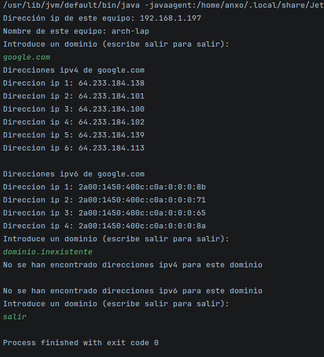

# Tarea 23 - Resolutor de nombres

## Alumno

- Anxo Vázquez Lorenzo - 2DAM

## Asignatura

- PSP

## Clase `Direcciones`

Esta clase contiene los siguientes métodos:

- `getLocalName()`-> Devuelve el `hostname` del anfitrión

- `getLocalIP()` -> Devuelve la `ip` del anfitrión

- `getIPsV6Dominio()` -> Devuelve una lista de direcciones `IPv6` de un dominio

- `getIPsV4Dominio()` -> Devuelve una lista de direcciones `IPv4` de un dominio

### Métodos `getIPsV6Dominio()` y `getIPsV4Dominio()`

Estos métodos devuelven una lista de `Strings` con direcciones `IPv4` o `IPv6` que tiene un dominio.

Para saber todas las direcciones de un dominio uso `InetAddress.getAllByName(dominio)` que me devuelve las direcciones `IPv4` e `IPv6` del dominio indicado. Después para identificar de qué tipo son compruebo a qué instancia pertenecen (`Inet4Address` o `Inet6Address`).

```java
for(InetAddress ip: InetAddress.getAllByName(dominio)){
    if(ip instanceof Inet4Address) {
        lista.add(ip.getHostAddress());
    }
}
```

## Clase `Main`

Esta clase contiene el método principal del programa que muestra la `ip` y `hostname` del anfitrión, después pide dominios indefinidamente hasta que el usuario indique `salir`.

## Ejecución



## Bibliografía

- Oracle Documentación oficial - `InetAddress, Inet4Address, Inet6Address`

  https://docs.oracle.com/javase/8/docs/api/java/net/Inet4Address.html#format

  https://docs.oracle.com/javase/8/docs/api/java/net/InetAddress.html#getAddress--

  https://docs.oracle.com/javase/8/docs/api/java/net/Inet6Address.html#format

>No he necesitado IA para esta tarea